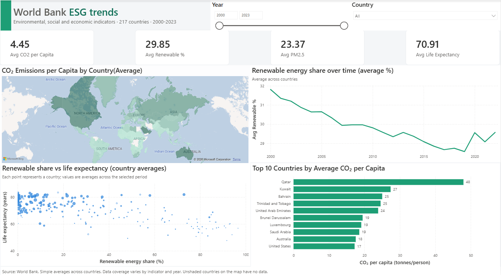
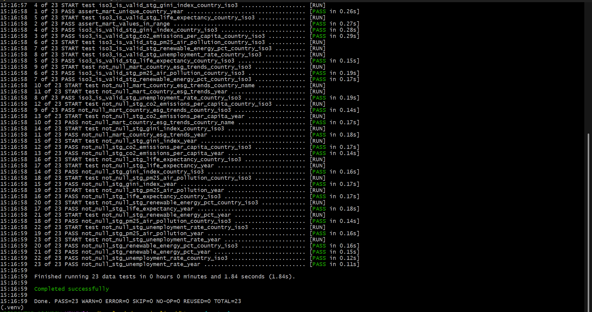

# World Bank ESG Data Pipeline & Dashboard

An end-to-end data engineering and business intelligence portfolio project that collects environmental and socioeconomic indicators from the World Bank API, stores them in PostgreSQL, transforms and tests the data with dbt, and presents country-level trends in Power BI.

**Project question:** How do environmental and socioeconomic indicators vary across countries and change over time?

## Dashboard Preview



## Architecture

```text
World Bank API
      |
      v
Python extraction
      |
      v
Raw JSON files
      |
      v
PostgreSQL (raw_esg schema)
      |
      v
dbt staging models
      |
      v
dbt country-year mart
      |
      v
Power BI dashboard
```

The pipeline components were developed and executed without Airflow orchestration. Data extraction, loading, transformation, and visualization were handled through their respective tools.

## Technology Stack

| Technology | Purpose |
|---|---|
| Python | Extracting data from the World Bank API and loading raw data into PostgreSQL |
| World Bank API | Public source of country-level development indicators |
| PostgreSQL | Storing raw indicator data and transformed datasets |
| dbt | Cleaning, transforming, modelling, and testing data using SQL |
| Power BI | Visualizing country-level trends and comparing indicators |
| Git and GitHub | Version control and project documentation |

## Indicators

The implemented pipeline uses six indicators for 217 countries from 2000 to 2023, across the environmental and social/economic dimensions.

| Pillar | Indicator | World Bank Code |
|---|---|---|
| Environmental | CO₂ emissions per capita | `EN.GHG.CO2.PC.CE.AR5` |
| Environmental | Renewable energy consumption (%) | `EG.FEC.RNEW.ZS` |
| Environmental | PM2.5 air pollution | `EN.ATM.PM25.MC.M3` |
| Social | Gini index (income inequality) | `SI.POV.GINI` |
| Social / economic | Unemployment rate | `SL.UEM.TOTL.ZS` |
| Social | Life expectancy at birth | `SP.DYN.LE00.IN` |

Governance indicators were considered during development but were not successfully integrated into the implemented dataset. The project therefore does not claim complete coverage of all three ESG pillars.

## Data Engineering Workflow

1. **Extraction:** Python retrieves indicator data from the World Bank API and saves raw JSON files.
2. **Loading:** A Python loader reads the extracted data and loads it into indicator tables in the PostgreSQL `raw_esg` schema.
3. **Transformation:** dbt staging models clean and standardize the source data, filter blank country codes and regional aggregates, and limit the data to 2000–2023.
4. **Data modelling:** dbt combines indicator data into a country-year mart (`mart_country_esg_trends`) with one row per country per year, 5,208 rows in total.
5. **Data quality:** 23 dbt tests validate keys, country-code format, grain uniqueness, and value ranges.
6. **Visualization:** Power BI connects to the resulting dataset to explore trends and compare countries.

## Dashboard Features

- Year and country filters.
- KPI cards summarizing selected-period averages.
- A country map for CO₂ emissions per capita.
- Renewable energy trends over time.
- A scatter plot comparing renewable energy consumption with life expectancy.
- A Top 10 comparison of countries by CO₂ emissions per capita.

## Data Quality: Issues Found and Fixed

The dbt tests caught real problems during development. Each one was investigated before any SQL was changed.

### 1. Blank country codes caused a join fan-out

- **Symptom:** The first `dbt test` run failed the unique country-year test on 24 groups. The mart had 28,512 rows, and 22,272 of them had a blank `country_iso3`.
- **Cause:** The API returns four World Bank income groups (High, Upper middle, Lower middle and Low income) with an empty ISO3 code. Joining on that code matched every blank row to every other blank row: 4 rows across 5 tables produced 1,024 rows per year, and 256 for the years where renewable energy data ends. The `not_null` test passed because the blanks were empty strings, not NULLs.
- **Fix:** Blank codes are filtered in every staging model. A seed (`seeds/aggregate_codes.csv`) lists 43 World Bank regional and income aggregates (such as `WLD`, `EUU` and `OED`) that are excluded in staging, and a custom generic test (`iso3_is_valid`) fails if a country code isn't exactly 3 characters.
- **Result:** The mart dropped to 5,208 rows, which is 217 countries × 24 years.

### 2. Outlier: Central African Republic life expectancy

The raw table contains life expectancy values of 14.665 (2009) and 18.818 (2022) for the Central African Republic, against about 40–57 in neighbouring years. They appear in the published World Bank series, so they are not pipeline errors, but they are implausible as typical lifespans. Values outside 30–95 are set to NULL in `stg_life_expectancy`, and the rows are kept so the other indicators survive. This is a documented judgment call, not a correction.

### 3. Outlier: Palau CO₂ per capita

Palau's CO₂ values range from about 64 to 203 tonnes per person in the raw data, against about 48 on average for the next-highest country (Qatar). External sources disagree on Palau: roughly 60–83 t/person in World Bank and EDGAR-based series versus about 13 t in Our World in Data. Palau's CO₂ values are set to NULL in `stg_co2_emissions_per_capita` so that one small country doesn't dominate the rankings and the map scale. Its other indicators are kept. This is a documented judgment call.

### Test suite

23 dbt data tests: `not_null` on country code and year in the staging models and the mart, `iso3_is_valid` on all six staging models, and singular tests for the unique country-year grain and plausible value ranges.



### Limitations

- Averages on the dashboard are simple averages across countries, not population-weighted.
- Coverage varies by indicator and year.
- The renewable energy indicator includes traditional biomass, so high shares in lower-income countries don't mean modern clean energy.
- Palau is excluded from CO₂ figures, and the Central African Republic's two life expectancy values are nulled.
- The aggregate list is a static seed, so new World Bank aggregate codes have to be added by hand.
- Governance indicators were not integrated, so the project covers environmental and social indicators only.
- The Power BI report needs a PostgreSQL connection to refresh.

## Repository Structure

```text
world-bank-esg-pipeline/
├── airflow/                  # Unfinished DAG skeleton; not part of the executed workflow
├── data/
│   └── raw/                  # Local raw extracts; excluded from Git
├── dbt_esg/
│   ├── macros/
│   ├── models/
│   │   ├── staging/
│   │   └── marts/
│   ├── seeds/
│   │   └── aggregate_codes.csv
│   ├── tests/
│   │   └── generic/
│   ├── dbt_project.yml
│   └── profiles.yml.example
├── docs/
│   ├── dashboard.png
│   ├── dbt-tests.png
│   └── ESG report.pbix
├── extraction/
│   ├── extract_worldbank_esg.py
│   ├── load_raw_to_postgres.py
│   └── requirements.txt
├── .gitignore
└── README.md
```

## Setup

### Prerequisites

- Python and pip
- PostgreSQL
- A dbt-compatible Python environment with dbt Core and the PostgreSQL adapter
- Power BI Desktop to open the report

### 1. Clone the repository

```bash
git clone https://github.com/Celz-4/world-bank-esg-pipeline.git
cd world-bank-esg-pipeline
```

### 2. Install Python dependencies

```bash
cd extraction
pip install -r requirements.txt
cd ..
```

Use a virtual environment where possible to keep dependencies isolated.

### 3. Configure PostgreSQL and dbt

Create the `esg_pipeline` database and configure your local dbt profile to connect to PostgreSQL. Use `dbt_esg/profiles.yml.example` as a reference. Set your database password through the `DBT_POSTGRES_PASSWORD` environment variable rather than committing it.

The repository intentionally excludes local credentials and the raw extract files.

### 4. Extract and Load the Raw Data

Run these commands from the repository root.

**Extract data from the World Bank API:**

```bash
python extraction/extract_worldbank_esg.py
```

The script fetches the configured indicators and saves the raw JSON files to `data/raw/<run_date>/`, using the current date.

**Load the extracted data into PostgreSQL:**

To load the current day's extraction:

```bash
python extraction/load_raw_to_postgres.py
```

To load a specific extraction, such as the run from October 2, 2026:

```bash
python extraction/load_raw_to_postgres.py 2026-10-02
```

Before loading, ensure that PostgreSQL is running, the `esg_pipeline` database and `raw_esg` schema exist, and the `DBT_POSTGRES_PASSWORD` environment variable is configured.

The loader flattens the JSON records, excludes records without country ISO3 codes, and writes each indicator to its own table in the `raw_esg` schema.

**Important:** The loader uses `if_exists="replace"`, meaning existing indicator tables are replaced when the corresponding files are loaded. The extraction script also handles individual indicator failures without necessarily stopping the entire run, so check its output to confirm which indicators were successfully retrieved.

### 5. Build and Test with dbt

Navigate to the dbt project directory:

```bash
cd dbt_esg
```

Activate your configured Python virtual environment if necessary, then run:

```bash
dbt debug
dbt seed
dbt run
dbt test
```

- `dbt debug` checks your database connection and project configuration.
- `dbt seed` loads the aggregate-code CSV used by the staging models.
- `dbt run` builds the staging models and analytical mart.
- `dbt test` runs the configured data quality tests.

These commands require a running PostgreSQL instance, successfully loaded raw tables, and a correctly configured dbt profile.


### 6. Open the Dashboard

Open `docs/ESG report.pbix` in Power BI Desktop. Configure a valid connection to your PostgreSQL environment if prompted.

## Future Improvements

- Add automated workflow orchestration and scheduling.
- Expand coverage to governance indicators.
- Add population-weighted metrics.
- Improve monitoring, logging, and recovery from failed pipeline steps.
- Explore a cloud data platform for scalable storage and transformation.

## Learning Outcomes

This project provided practical experience with API-based data extraction, Python data loading, relational databases, SQL transformations, dbt modelling and testing, investigating and documenting data-quality issues, BI integration, version control, and documenting a data pipeline.

## Data Source

World Bank Open Data — https://data.worldbank.org/

The data is publicly available through the World Bank API.